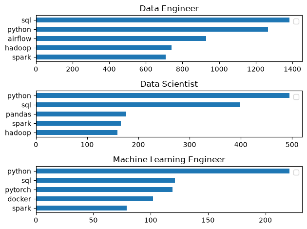

# The Analysis 

## 1. What are the most demanded skills for top 3 most popular data roles in Russia?

To find the most demanded skills for the top 3 most popular data roles in Russia, I filtered the dataset to identify the most common positions and extracted the top 5 skills for each role. This analysis highlights the core technologies required in the Russian job market, providing clear insights into which skills to prioritize depending on the targeted role.

View my notebook with detailed steps here: [2_Skills_Count.ipynb](3_Project/2_Skills_Count.ipynb)

### Visualize Data
```python
fig , ax = plt.subplots(len(job_titles), 1)

for i , job_title in enumerate(job_titles):
    df_plot = df_skills_count[df_skills_count['job_title_short']== job_title].head(5)
    df_plot[::-1].plot(kind='barh', x= 'job_skills', y= 'skill_count', ax=ax[i], title= job_title)
    ax[i].set_ylabel('')
    ax[i].set_xlabel('')
    ax[i].legend('')
plt.tight_layout()   
```

## Results


### Insights

- **Python and SQL are essential across all data roles:** Both skills consistently dominate the top rankings. SQL is the #1 required skill for Data Engineers, while Python is the clear leader for Data Scientists and Machine Learning Engineers.
- **Data Engineers focus heavily on data pipelines and big data tools:** Unlike the other roles, Data Engineering demand is strongly driven by orchestration and distributed systems, specifically **Airflow**, **Hadoop**, and **Spark**.
- **Machine Learning Engineers require deep learning and containerization:** Beyond programming and SQL, ML Engineers are uniquely expected to know framework and deployment tools like **PyTorch** and **Docker**.